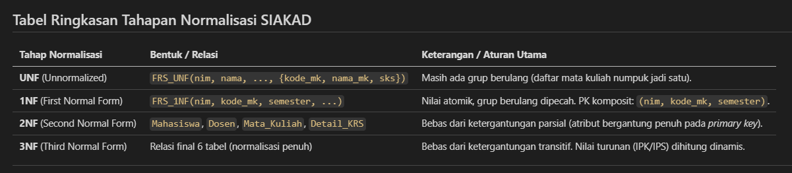

# Laporan Praktikum Basis Data - Pertemuan 4

**Nama:** Chantika Regina Bria Putri  
**NIM:** 25430082  
**Kelas:** C 
**Tanggal:** 19 Oktober 2026  
**Dosen:** Dedi Irawan, S.Kom., M.T.I.  

---

## 1. Tujuan Praktikum
1. Mengidentifikasi anomali ubah, sisip, dan hapus pada data yang belum dinormalisasi.
2. Menuliskan dependensi fungsional (functional dependency) dari aturan bisnis organisasi.
3. Menormalisasi relasi data dari bentuk mentah (UNF) hingga bentuk normal ketiga (3NF) dan memeriksa BCNF.
4. Memutuskan penyimpanan nilai turunan serta mendokumentasikan skema relasional akhir secara konsisten.

---

## 2. Ringkasan Dasar Teori
Normalisasi adalah proses menstrukturkan data relasional untuk menghilangkan anomali data (anomali sisip, ubah, dan hapus) serta menghindari duplikasi data yang tidak perlu. Proses normalisasi dilakukan secara bertahap:
- **UNF (Unnormalized Form):** Bentuk mentah dokumen/spreadsheet yang masih memuat grup berulang (*repeating group*).
- **1NF (First Normal Form):** Seluruh nilai bernilai atomik dan tidak ada lagi grup berulang. Kunci primer berbentuk komposit.
- **2NF (Second Normal Form):** Memenuhi 1NF dan tidak ada ketergantungan parsial (seluruh atribut non-kunci bergantung penuh pada kunci primer).
- **3NF (Third Normal Form):** Memenuhi 2NF dan tidak ada ketergantungan transitif (atribut non-kunci tidak boleh bergantung pada atribut non-kunci lainnya).
- **BCNF (Boyce-Codd Normal Form):** Setiap penentu (*determinant*) adalah kunci kandidat.

---

## 3. Hasil Langkah Percobaan
Percobaan normalisasi dilakukan dengan menganalisis formulir atau dokumen sumber Sistem Informasi Akademik (SIAKAD), yaitu **Formulir Rencana Studi (FRS)**. Pada data awal yang belum dinormalisasi, terdapat potensi anomali seperti duplikasi data identitas mahasiswa dan dosen pada setiap mata kuliah yang diambil (anomali ubah), serta kesulitan mencatat data mata kuliah baru jika belum ada mahasiswa yang mengambilnya (anomali sisip).

### Tabel Ringkasan Tahapan Normalisasi (SIAKAD):
| Tahap | Bentuk Relasi / Tabel | Keterangan / Solusi Anomali |
| :--- | :--- | :--- |
| **UNF** | `FRS_UNF(nim, nama_mahasiswa, prodi, nip_pa, nama_dosen, semester, status_acc, {kode_mk, nama_mk, sks})` | Masih memuat kelompok data berulang (*repeating group*) berupa daftar mata kuliah dalam satu FRS. |
| **1NF** | `FRS_1NF(nim, kode_mk, semester, nama_mahasiswa, prodi, nip_pa, nama_dosen, status_acc, nama_mk, sks)` | Grup berulang dipecah menjadi baris atomik. PK Komposit: `(nim, kode_mk, semester)`. |
| **2NF** | `mahasiswa`, `dosen`, `mata_kuliah`, `detail_krs_2nf` | Mengeliminasi ketergantungan parsial (atribut non-kunci dipisah berdasarkan kunci utamanya masing-masing). |
| **3NF** | `dosen`, `mahasiswa`, `mata_kuliah`, `krs`, `detail_krs`, `nilai` | Mengeliminasi ketergantungan transitif. Skema final dibagi menjadi 6 tabel terelasi secara utuh. |

---

## 4. Jawaban Titik Analisis

### Titik Analisis 1:
- **Pertanyaan:** Mengapa FD5 menempatkan `harga_satuan_detail_penjualan` pada kunci komposit `(no_nota_penjualan, kode_barang)` dan bukan pada `kode_barang` saja? Apa yang terjadi pada laporan omzet tahun lalu jika harga dipindah ke tabel `barang`?
- **Jawaban:** Karena harga barang bersifat dinamis dan dapat berubah sewaktu-waktu. Sesuai aturan bisnis AB-04, harga yang digunakan pada nota adalah harga transaksi saat kejadian tersebut terjadi. Jika harga hanya disimpan di tabel `barang`, saat harga barang naik di kemudian hari, seluruh catatan omzet nota lama ikut berubah secara salah (anomali ubah) sehingga laporan keuangan historis menjadi tidak akurat.

### Titik Analisis 2:
- **Pertanyaan:** Keputusan "total tidak disimpan" akan ditinjau ulang di Buku 2 ketika tabel arsip penjualan justru menyimpan total. Mengapa keputusan yang berbeda itu tetap konsisten?
- **Jawaban:** Pada data operasional (OLTP), data masih aktif bertambah atau berubah sehingga nilai turunan seperti `total` dihitung langsung lewat kueri untuk mencegah inkonsistensi data jika ada revisi detail barang. Sebaliknya, pada tabel arsip/historis, transaksi sudah final dan tidak akan pernah diubah lagi. Menyimpan `total` pada data arsip bertujuan menghemat beban komputasi/agregasi saat analisis laporan masa lalu.

### Titik Analisis 3:
- **Pertanyaan:** Kolom `pemasok_brg` di spreadsheet lama tidak muncul di tabel `barang`. Di mana informasi "barang ini dipasok oleh siapa" kini disimpan, dan apa keuntungannya?
- **Jawaban:** Informasi pemasok kini disimpan pada relasi transaksi `pembelian` dan `detail_pembelian`. Keuntungannya adalah organisasi dapat membeli barang yang sama dari pemasok yang berbeda-beda tanpa harus mengubah data induk barang atau merusak histori pendaftaran barang.

---

## 5. Hasil Latihan dan Modifikasi
1. **Normalisasi Kontak Pemasok Multivalue:**
   Jika pemasok memiliki banyak nomor telepon, atribut `telepon_pemasok` dipisah menjadi entitas terpisah `telepon_pemasok(id_telepon, id_pemasok, no_telepon)` dengan relasi 1-to-N terhadap tabel `pemasok`.
2. **Simulasi Anomali Ubah jika 3NF Dilanggar:**
   Jika `nama_anggota` disimpan di tabel `penjualan`, ketika anggota mengubah namanya, kueri `UPDATE` harus memperbarui puluhan baris nota lama. Jika ada baris yang terlewat, nama anggota tersebut menjadi tidak konsisten.

---

## 6. Tugas Mandiri: Milestone Proyek 4 (SIAKAD)
Dokumen analisis lengkap dan skema 3NF untuk proyek Sistem Informasi Akademik (SIAKAD) telah didokumentasikan pada file **`p04_normalisasi_25430082.md`** di repositori.

### Ringkasan Skema Relasional 3NF Proyek SIAKAD:
1. **`dosen`** (`nip_dosen` [PK], `nama_dosen`, `email_dosen`, `no_hp_dosen`)
2. **`mahasiswa`** (`nim` [PK], `nama_mahasiswa`, `prodi`, `status_aktif`, `nik_mahasiswa`, `nip_pa` [FK])
3. **`mata_kuliah`** (`kode_mk` [PK], `nama_mk`, `sks`, `semester_penawaran`)
4. **`krs`** (`id_krs` [PK], `semester`, `tahun_ajaran`, `status_acc`, `tgl_pengajuan`, `nim` [FK])
5. **`detail_krs`** (`id_detail_krs` [PK], `id_krs` [FK], `kode_mk` [FK])
6. **`nilai`** (`id_nilai` [PK], `id_detail_krs` [FK], `nilai_angka`, `nilai_huruf`)

### Keputusan Nilai Turunan:
Nilai `IPS` (Indeks Prestasi Semester) dan `IPK` (Indeks Prestasi Kumulatif) **tidak disimpan** di tabel operasional, melainkan dihitung secara dinamis saat kueri KHS/Transkrip dijalankan untuk menjamin konsistensi data.

---

## 7. Pembahasan dan Kendala
- **Kendala:** Sempat pusing memahami perbedaan ketergantungan parsial (2NF) dan ketergantungan transitif (3NF) saat menentukan kunci komposit pada transaksi KRS.
- **Solusi:** Membedakan bahwa 2NF fokus memecah atribut yang hanya bergantung pada *sebagian* kunci komposit, sedangkan 3NF memecah atribut non-kunci yang saling menentukan satu sama lain (seperti `nip_pa` yang menentukan `nama_dosen` di tabel mahasiswa).

---

## 8. Kesimpulan
1. Normalisasi terbukti menghilangkan anomali data (sisip, ubah, dan hapus) dengan memecah tabel besar menjadi beberapa tabel terelasi.
2. Aturan bisnis ($\text{AB-xx}$) menjadi pedoman utama dalam menentukan dependensi fungsional (FD).
3. Keputusan tidak menyimpan nilai turunan di tabel operasional efektif mencegah timbulnya data yang tidak konsisten di kemudian hari.

---

## 9. Pernyataan Penggunaan AI
Menggunakan Gemini untuk memahami konsep ketergantungan fungsional dan memverifikasi kesesuaian skema 3NF SIAKAD dengan checklist modul.

---

## 10. Bukti Git
- **Tautan Repositori:** [https://github.com/chantikaregina/basisdata-25430082](https://github.com/chantikaregina/basisdata-25430082)
- **Hash Commit Pertemuan 4:** `p04: milestone proyek 4 normalisasi 3nf`

---

## Checklist Khusus Pertemuan 4
- [x] Berkas wajib: `p04_normalisasi_25430082.md` (proyek)
- [x] Bukti tangkapan layar: Tabel tahapan UNF → 1NF → 2NF → 3NF
- [x] Analisis wajib: Daftar dependensi fungsional; keputusan menyimpan atau menghitung nilai turunan beserta alasannya